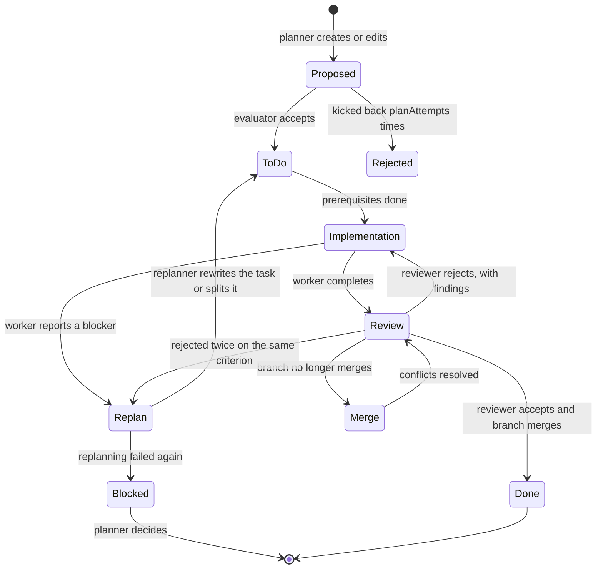

# Agent Coordinator

A local service that turns a written request into a board of tasks and runs coding agents on them until the work is done. A planner agent breaks the request into tasks, an evaluator checks the plan, workers do each task on its own git branch, reviewers accept or send the work back, and accepted work is merged. Everything happens on your machine, in folders you choose.

The coordinator is written in Rust and runs agents through their own command-line harnesses: [Claude Code](https://docs.claude.com/en/docs/claude-code) (`claude`) or the Codex CLI (`codex`). The board, task panel, planner transcript and analytics are in the companion web UI, [agent_tasks_ui](https://github.com/tristan00/agent_tasks_ui).

## Contents

- [Requirements](#requirements)
- [Build and run](#build-and-run)
- [Concepts](#concepts)
- [How a request becomes finished work](#how-a-request-becomes-finished-work)
- [Task lifecycle](#task-lifecycle)
- [Agents and models](#agents-and-models)
- [Workspace settings](#workspace-settings)
- [Prompts](#prompts)
- [Git](#git)
- [Running workers safely](#running-workers-safely)
- [Data and evidence](#data-and-evidence)
- [Coordinator configuration](#coordinator-configuration)
- [HTTP API](#http-api)
- [Redeploying the coordinator](#redeploying-the-coordinator)
- [Development](#development)

## Requirements

- Windows. The coordinator uses Windows job objects to contain and account for every agent process.
- Rust stable with the `x86_64-pc-windows-gnu` toolchain (pinned in `rust-toolchain.toml`).
- Git on `PATH`.
- At least one agent harness on `PATH`, signed in: `claude` for Anthropic models or `codex` for OpenAI models.

## Build and run

```bash
cargo build --release
```

```bash
target/release/agent-coordinator.exe
```

Start the coordinator from inside a Claude Code or Codex session. It detects which harness launched it and enables only that vendor's models; set `AGENT_FAMILY=claude` or `AGENT_FAMILY=codex` to choose explicitly. The detected family is remembered across restarts.

| Variable | Default | Purpose |
|---|---|---|
| `PORT` | `4242` | HTTP port; the server listens on `127.0.0.1` only |
| `COORDINATOR_DATA` | `%LOCALAPPDATA%\AgentCoordinator` | Board state, attempts, sessions and deployed builds. Must be outside the source directory |
| `COORDINATOR_PROMPTS` | `prompts/` in the source tree | Directory of default prompts and settings |
| `AGENT_FAMILY` | detected | `claude` or `codex` |

Open `http://127.0.0.1:4242` for the UI once it has been deployed (see [agent_tasks_ui](https://github.com/tristan00/agent_tasks_ui)). `GET /api` lists every route with an example body.

A first request looks like this:

```bash
curl -X POST http://127.0.0.1:4242/api/workspaces -H "Content-Type: application/json" -d "{\"path\":\"D:/work/my_workspace\"}"
```

```bash
curl -X POST http://127.0.0.1:4242/api/sessions -H "Content-Type: application/json" -d "{\"workspace\":\"D:/work/my_workspace\",\"directory\":\"D:/work/my_workspace/my_project\",\"request\":\"Add CSV export to the report command\"}"
```

## Concepts

| Term | Meaning |
|---|---|
| **Workspace** | A folder the coordinator manages, with its own settings, prompts and task numbering. Creating one writes `AGENTS.md` (the endpoint guide every agent reads) and `LIMITS.json` into it. Task ids are short and per workspace, such as `MW-12` for `my_workspace` |
| **Session** | One planner working on requests in a project folder inside a workspace. A finished session can take a follow-up request. A session owns the tasks its planner created and their children; when a newer session starts in the same folder, the older session's unfinished tasks stop being dispatched |
| **Task** | A unit of work with a title, an outcome, a working folder and up to a few acceptance criteria |
| **Container** | A task with no acceptance criteria. It groups child tasks, runs no worker and is done when its children are |
| **Attempt** | One run of one agent on one task at one stage: implementation, review, replan or merge. Every attempt keeps its prompt, event stream, result, usage and CPU time |
| **Relations** | `dependencies` (uses the target's result, with a reason), `after` (waits for the target to settle), `conflicts` (never runs at the same time) and `related` (no ordering) |

## How a request becomes finished work

1. **Plan.** `POST /api/sessions` starts a planner agent in the project folder with the request and the workspace's planner prompt. The planner creates tasks through the HTTP API, usually as a container with children (`POST /api/tasks/batch`), and ends its turn.
2. **Evaluate.** New and changed tasks start as *proposed*. The evaluator reads the request, the board and each proposal, then accepts it or kicks it back with findings. A task kicked back `planAttempts` times is rejected, and so is every task that depends on it. A proposal is evaluated only once everything it depends on has been accepted.
3. **Implement.** The scheduler starts a worker for every task whose prerequisites are done, in priority order. Each worker runs in its own git worktree and branch, with the role prompt for its task and the coordinator's worker protocol, and returns a structured result: what it checked, each criterion it believes it met, and any blocker.
4. **Review.** A reviewer, read-only, checks the work against every acceptance criterion and either accepts it or rejects it with findings.
5. **Merge.** Accepted work is merged into the project's main branch. Work that can no longer merge cleanly goes to a merge step, then straight back to review.
6. **Report.** The coordinator wakes the planner when tasks finish, when a task needs a decision, when a worker uses a lot of compute, and on a timer while work runs. The planner adjusts the plan or ends its turn. The session finishes when nothing more can run.

## Task lifecycle



- **Retries.** An attempt that crashes or times out is retried with backoff. A usage-limit message pauses dispatch until the reported reset time.
- **Escalation.** After `escalateAfter` failed implementation attempts, the next attempt uses the `escalation` model instead of the default worker.
- **Replanning.** The replanner reads the task, its attempts and the review findings, and returns a rewritten task or a set of child tasks.
- **Decisions.** A task that is held, blocked after replanning, or whose replanning failed twice is surfaced to the planner, which can correct it, resume it, replace it or delete it.
- **Stop and resume.** Any task, or the whole board, can be stopped and resumed. Stopping kills the worker's whole process tree.

## Agents and models

Each role is filled by an agent id from the built-in catalog or from the workspace's own `agents` map. Each agent names a provider, a harness, a model and a reasoning effort.

| Setting | Runs |
|---|---|
| `planner` | Plans the request and answers wake-ups |
| `evaluator` | Checks proposed tasks before workers take them |
| `worker` | Implements tasks; a task can request another model with `model` |
| `reviewer` | Reviews completed work |
| `escalation` | Takes over implementation after repeated failures |

`GET /api/agents?workspace=W` lists the worker models a task can request in that workspace. Hosted models run only in their own vendor's harness, and only the family that launched the coordinator is enabled.

## Workspace settings

`POST /api/workspaces` takes `path` and optional `settings`; anything omitted comes from `prompts/settings.json`.

| Field | Meaning |
|---|---|
| `planner`, `worker`, `reviewer`, `escalation`, `evaluator` | Agent ids for each role |
| `escalateAfter` | Failed implementation attempts before the escalation model takes over |
| `planAttempts` | Times a proposal can be kicked back before it is rejected |
| `plannerWakeMinutes` | How often the planner is woken while work runs |
| `computeAlertCpuMinutes` | Worker CPU time after which the planner is asked whether the work is worth it |
| `updates` | `events` (long-poll `GET /api/updates`) or `poll` |
| `limits` | Word and count limits on task definitions and results: `words`, `titleWords`, `criteria`, `summaryWords`, `findings`, `findingWords` |
| `agents` | Optional custom agent definitions |
| `kickoff` | Set `false` to create the plan without dispatching workers |

`GET /api/task-schema?workspace=W` returns the full JSON schema for tasks and batches in a workspace, with every rule, role, size, dependency reason and limit, so agents can build valid tasks on the first try. A rejected create or edit reports every problem at once.

## Prompts

`prompts/` holds one short prompt per kind of agent: the project planner, the plan evaluator, the reviewer, the replanner, the general worker protocol, and role prompts for specialist workers such as backend code, UI code, tests, docs, data, research, design, optimization and audits. A task's `attributes.role` picks its role prompt; tasks without a role get the worker protocol.

- Each prompt is at most 200 words.
- A workspace records the SHA-256 of every prompt it uses when it is created. If a prompt file changes later, that workspace refuses to start agents until it is recreated, so a run never mixes prompt versions.
- `GET /api/workspaces/defaults` shows the current defaults and their word counts.

## Git

- A session's project folder becomes a git repository if it is not one already.
- Each task works in `<workspace>/worktrees/<task id>` on branch `task/<task id>`.
- Before implementation, the main branch is merged into the task branch, and any conflicts are left for the worker to resolve. Before review, the coordinator merges main again; if that conflicts, the task goes to the merge step instead of review.
- After a worker finishes, any uncommitted work is committed for it.
- When review accepts, the branch is merged with `--no-ff` into main and the worktree is removed.

## Running workers safely

- Every attempt runs under a supervisor process inside a Windows job object. When the worker exits, everything it started is killed, and its CPU time is recorded.
- A **kill guard** puts wrappers for `taskkill`, `pkill` and `killall` first on each agent's `PATH`. They refuse to kill by name or filter, which would also stop other agents' processes, and allow killing a specific PID.
- Temporary files go to `<workspace>/tmp`, and each attempt has its own scratch folder.
- Reviewers, replanners and the evaluator run read-only.

## Data and evidence

The data directory (`COORDINATOR_DATA`) holds:

| Path | Contents |
|---|---|
| `state.json` | The board: tasks, workspaces, sessions, settings |
| `attempts/<attempt id>/` | `request.json`, `events.jsonl` (the agent's event stream), `result.json`, `exit.json`, `usage.json`, `cpu.json` and the log |
| `sessions/<session id>/` | Each planner turn and evaluation, with its prompt and transcript |
| `ui/` | Deployed UI builds; `current` names the one being served |
| `deployed/`, `build/` | Coordinator builds and the build cache used for redeploys |

Each workspace also gets an `agent_activity.csv` with one row per agent action (tool calls, commands, edits) across all tasks. `GET /api/analytics` reports, per task, first-pass success, attempts, review rejections, replans and lead time. `POST /api/analytics` with `groupBy` (`workspace`, `role`, `size`, `priority`, `needs`, `artifact`, `criteria`, `relations` or `container`) summarises them by group.

## Coordinator configuration

`PUT /api/config` replaces the coordinator-wide configuration; `GET /api/state` returns it under `config`.

| Field | Meaning |
|---|---|
| `implementation`, `review`, `replan` | The command that runs a worker at each stage. The default is the coordinator's own `--agent` mode, which launches the harness for the task's model |
| `capabilities` | What the workers on this machine can do, such as `process` and `network`. Tasks can only list these in `needs` |
| `notify` | Optional command that receives held, usage-limit and deploy events as JSON on stdin |
| `workspaces` | Every workspace's settings, keyed by path |

## HTTP API

All bodies are JSON with `Content-Type: application/json`. `W` is a workspace path, URL-encoded; passing a project folder inside it narrows the results to that folder.

**Tasks** (also available to agents)

| Route | Use |
|---|---|
| `GET /api` | Every route with an example body |
| `GET /api/task-schema?workspace=W` | Task and batch schema, rules and limits |
| `GET /api/tasks?workspace=W` | List tasks |
| `GET /api/tasks/{id}` | Read one task, with history and attempts |
| `POST /api/tasks` | Create a task |
| `POST /api/tasks/batch` | Create a container and its children at once |
| `PATCH /api/tasks/{id}` | Correct a task that is not running |
| `POST /api/tasks/{id}/stop`, `/resume` | Stop or resume a task |
| `POST /api/tasks/{id}/replan` | Ask for a task to be replanned |
| `DELETE /api/tasks/{id}` | Remove a task |
| `GET /api/updates?workspace=W&after=SEQ&wait=S` | Changes after a sequence number |
| `GET /api/agents?workspace=W` | Models a task can request |
| `GET /api/attempts/{id}/log` | An attempt's log |
| `GET /api/sessions/{id}` | A planner session |

**Sessions, workspaces and the board**

| Route | Use |
|---|---|
| `POST /api/workspaces` | Create a workspace |
| `GET /api/workspaces/defaults` | Default prompts and settings |
| `POST /api/sessions` | Start a session: `workspace`, `directory`, `request` |
| `GET /api/sessions` | List sessions |
| `POST /api/sessions/{id}/messages` | Send a follow-up request to a finished session |
| `POST /api/sessions/{id}/stop` | Stop a session and its tasks |
| `GET /api/sessions/{id}/requests/{n}/events?after=OFFSET` | Planner transcript |
| `GET /api/state` | The whole board |
| `GET /api/analytics`, `POST /api/analytics` | Analytics report |
| `PUT /api/config` | Replace the coordinator configuration |
| `POST /api/stop`, `POST /api/resume` | Pause or resume all work |
| `POST /api/wipe` | Remove every task |

**Deployment**

| Route | Use |
|---|---|
| `GET /api/deployment` | Running build, UI version and data directory |
| `POST /api/deployment` | Redeploy from `source` (a source directory) or `candidate` (an executable) |
| `GET /api/deployment/requests/{id}` | Progress of a redeploy |
| `POST /api/deployment/quiesce`, `/handoff` | Internal steps of a handoff |
| `GET /api/kill-guard` | Kill guard directory and variable |

## Redeploying the coordinator

The coordinator can replace itself without losing the board or running workers:

```bash
curl -X POST http://127.0.0.1:4242/api/deployment -H "Content-Type: application/json" -d "{\"source\":\"D:/path/to/agent_coordinator\"}"
```

It builds the source, starts the new build, hands over the port and state, and checks the new build is live. Poll the returned receipt (`GET /api/deployment/requests/{id}`) until its status is `verified_live`. Each build is kept under `deployed/<digest>`, so a rollback is a handoff to the previous one. A task with `attributes.deploy` set deploys its own accepted build the same way.

## Development

```bash
cargo test
```

Project rules for anyone, human or agent, changing this code are in `AGENTS.md`. Among them: the backend stays in Rust, there are no comments or docstrings, backend code stays under 8000 lines excluding tests, and data never goes under the source directory.
